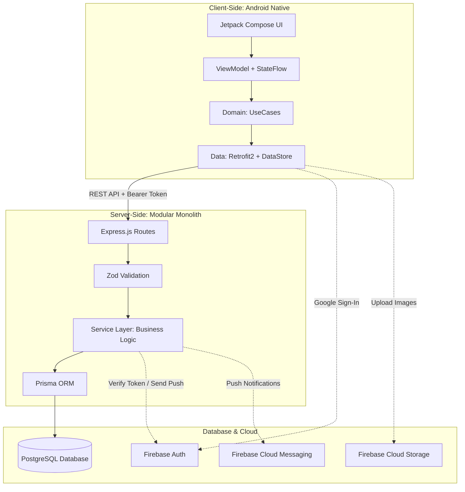

# 🍳 Food Social App

> **Mạng xã hội ẩm thực thông minh kết hợp quản lý tủ lạnh, danh sách đi chợ và cá nhân hóa chế độ dinh dưỡng.**

---

## 📖 1. Giới thiệu tổng quan

**Food Social App** là nền tảng ứng dụng di động dành cho cộng đồng yêu nấu ăn. Không chỉ dừng lại ở việc chia sẻ và tìm kiếm công thức, ứng dụng giải quyết triệt để các bài toán thực tế hàng ngày trong căn bếp:
* **"Hôm nay ăn gì với những gì còn trong tủ lạnh?"** $\rightarrow$ Hệ thống gợi ý công thức dựa trên nguyên liệu sẵn có.
* **"Đi chợ mua bao nhiêu cho đủ khi nấu nhiều món?"** $\rightarrow$ Giỏ hàng tự động cộng dồn khối lượng theo đơn vị đo chuẩn và truy vết nguồn gốc công thức.
* **"Làm sao tránh các món chứa chất dị ứng của bản thân?"** $\rightarrow$ Bộ lọc đa tầng thông minh tự động loại trừ nguyên liệu gây dị ứng và cho phép lưu lại bộ lọc yêu thích chỉ với một chạm.
* **"Món ăn nấu thực tế trông như thế nào?"** $\rightarrow$ Tính năng **Cooksnap** cho phép cộng đồng đăng tải hình ảnh thành quả thực tế kèm đánh giá khách quan.

---

## ✨ 2. Các tính năng cốt lõi

### 🔐 Quản lý Tài khoản & Cá nhân hóa
* **Đăng nhập an toàn:** Tích hợp Google Sign-In (Firebase Authentication) nhanh chóng, bảo mật cao.
* **Định danh độc nhất:** Mỗi người dùng thiết lập một `nickname` duy nhất để định danh và phục vụ tìm kiếm.
* **Hồ sơ dị ứng:** Thiết lập danh sách các nguyên liệu gây dị ứng của bản thân để hệ thống tự động cảnh báo và loại trừ khi khám phá món ăn.

### 🍲 Quản lý Công thức & Danh mục
* **Sáng tạo công thức:** Đăng tải bài viết kèm hình ảnh minh họa, khẩu phần, thời gian nấu và hướng dẫn chi tiết từng bước.
* **Từ điển nguyên liệu chuẩn:** Định lượng nguyên liệu theo đơn vị chuẩn (`gram`, `ml`, `quả`), phục vụ tính toán tự động.
* **Phân loại đa dạng:** Phân nhóm theo danh mục bữa ăn (Bữa chính, Tráng miệng, Bánh) và gắn thẻ chế độ ăn kiêng (Eat Clean, Keto, Ăn chay, Low-Carb...).
* **Bộ sưu tập yêu thích:** Lưu lại những công thức tâm đắc vào danh sách cá nhân để xem lại nhanh chóng.

### 🧊 Tủ lạnh thông minh (Smart Fridge)
* Người dùng cập nhật các nguyên liệu hiện có trong bếp.
* Thuật toán đối chiếu thông minh tự động phân tích và xếp hạng các công thức nấu ăn có **tỷ lệ khớp nguyên liệu cao nhất** lên đầu danh sách.

### 🛒 Danh sách đi chợ & Truy vết nguồn (Smart Shopping List)
* Cho phép thêm nguyên liệu từ nhiều món ăn khác nhau vào chung một giỏ hàng.
* **Tự động cộng dồn:** Các nguyên liệu trùng lặp tự động được cộng tổng khối lượng theo đơn vị chuẩn (ví dụ: Thịt bò $300g$ + $200g = 500g$).
* **Truy vết công thức:** Nhấn vào từng mục để xem chi tiết nguyên liệu đó được đóng góp từ những món ăn nào với số lượng bao nhiêu.

### 🔍 Tìm kiếm toàn cục & Bộ lọc cá nhân (Saved Filters)
* **Global Search:** Thanh tìm kiếm đa năng hỗ trợ tìm kiếm song song cả công thức nấu ăn và hồ sơ đầu bếp theo nickname.
* **Lưu bộ lọc 1 chạm:** Lưu lại các tổ hợp bộ lọc phức tạp (Danh mục + Chế độ ăn + Thời gian tối đa + Loại trừ dị ứng) để áp dụng ngay lập tức cho những lần mở app sau mà không cần chọn lại từ đầu.

### 👥 Tương tác cộng đồng & Mạng xã hội
* **Follow & News Feed:** Theo dõi các đầu bếp yêu thích và cập nhật công thức mới nhất qua Bảng tin thời gian thực.
* **Đánh giá đa phương tiện:** Chấm điểm sao (1–5 sao), viết bình luận đánh giá chi tiết.
* **Cooksnap:** Tải lên hình ảnh món ăn tự nấu thực tế để xác thực chất lượng và tương tác cùng tác giả công thức.

### 🔔 Hệ thống thông báo & Cấu hình đám mây
* **Push Notifications thời gian thực:** Nhận thông báo tức thì qua Firebase Cloud Messaging (FCM) khi có người theo dõi, đánh giá hoặc đăng Cooksnap vào công thức của mình.
* **App Links (Deep Linking):** Chia sẻ liên kết mở thẳng trang chi tiết công thức trên ứng dụng di động.

---

## 🏗️ 3. Kiến trúc hệ thống & Ngăn xếp công nghệ

Hệ thống được thiết kế theo mô hình **Hybrid Client-Server** kết hợp **Modular Monolith**:



### Chi tiết Tech Stack:

| Thành phần | Công nghệ sử dụng | Mục đích chính |
| :--- | :--- | :--- |
| **Android Client** | Kotlin, Jetpack Compose | Giao diện người dùng hiện đại, hiệu năng cao, phản hồi mượt mà |
| **Kiến trúc Client** | Clean Architecture, MVVM, UDF | Tách bạch rõ ràng giữa Presentation, Domain và Data |
| **DI & Bất đồng bộ** | Dagger Hilt, Coroutines, Flow | Quản lý phụ thuộc và xử lý luồng dữ liệu thời gian thực |
| **Mạng & Hình ảnh** | Retrofit2, OkHttp, Coil | Giao tiếp REST API và tối ưu cache hình ảnh cho Compose |
| **Backend Runtime** | Node.js, Express.js (TypeScript) | Xử lý logic nghiệp vụ tập trung, hiệu năng I/O cao |
| **Cơ sở dữ liệu** | PostgreSQL (19 bảng) | Lưu trữ dữ liệu quan hệ phức tạp, bảo đảm tính toàn vẹn ACID |
| **ORM & Validation** | Prisma ORM, Zod | Type-safe database queries và kiểm duyệt dữ liệu đầu vào |
| **Dịch vụ Đám mây** | Firebase (Auth, Storage, FCM) | Xác thực Google, lưu file đa phương tiện và thông báo đẩy |

---

## 📂 4. Cấu trúc thư mục dự án

```text
Food-Social-App/
├── android/                                    # Ứng dụng Android Native (Kotlin + Compose)
│   └── app/src/main/
│       ├── java/com/foodsocial/app/
│       │   ├── core/                           # Hạ tầng dùng chung (network, di, theme, utils)
│       │   ├── data/                           # Data Sources, DTOs, Repository Implementation
│       │   ├── domain/                         # Domain Models & Business UseCases
│       │   └── features/                       # Màn hình & ViewModel chia theo tính năng
│       └── res/                                # Drawable, Vector icons, Strings đa ngôn ngữ
│
├── backend/                                    # Máy chủ API (Node.js + Express + Prisma)
│   ├── prisma/                                 # schema.prisma (19 bảng) & seed.ts
│   ├── tests/                                  # Unit & Integration Tests
│   └── src/
│       ├── config/                             # Cấu hình môi trường, DB, Firebase Admin
│       ├── common/                             # Middlewares, Custom Errors, Tiện ích chung
│       ├── types/                              # Kiểu dữ liệu TypeScript toàn cục
│       └── modules/                            # Modular Monolith theo từng phân hệ chức năng
│           ├── auth/                           # Xác thực tài khoản Google
│           ├── users/                          # Hồ sơ cá nhân & dị ứng
│           ├── recipes/                        # Quản lý công thức, bước nấu, tags
│           ├── fridge/                         # Tủ lạnh thông minh & Thuật toán gợi ý
│           ├── shopping-list/                  # Giỏ hàng đi chợ & Cộng dồn khối lượng
│           ├── search/                         # Tìm kiếm toàn cục & Lưu bộ lọc
│           ├── social/                         # Follow, News Feed, Review, Cooksnap
│           └── notifications/                  # FCM Token & Lịch sử thông báo
│
├── .github/                                    # GitHub Templates (Pull Request Template)
├── CONTRIBUTING.md                             # Quy chuẩn phát triển Git, Branching & Commits
└── README.md                                   # Tài liệu giới thiệu tổng quan dự án
```

---

## 🗺️ 5. Lộ trình phát triển 4 giai đoạn (Roadmap)

| Chặng | Tên giai đoạn | Các bảng CSDL trọng tâm | Mục tiêu hoàn thành (Deliverables) |
| :---: | :--- | :--- | :--- |
| **1** | **Nền tảng & Xác thực** | `users`, `categories`, `dietary_regimes`, `ingredients` | Đăng nhập Google, thiết lập nickname độc nhất, nạp sẵn bộ từ điển nguyên liệu & danh mục chuẩn. |
| **2** | **Công thức & Yêu thích** | `recipes`, `recipe_steps`, `recipe_ingredients`, `recipe_dietary_tags`, `favorite_recipes` | Đăng tải món ăn, xem chi tiết các bước, tìm kiếm cơ bản và bấm lưu món yêu thích. |
| **3** | **Tiện ích Thông minh** | `user_allergies`, `saved_filters`, `user_fridge_items`, `shopping_list_items`, `shopping_list_recipe_sources` | Lọc tự động trừ dị ứng, Lưu bộ lọc 1 chạm, Thuật toán gợi ý món từ tủ lạnh, Tự động cộng dồn giỏ đi chợ. |
| **4** | **Cộng đồng & Hệ sinh thái** | `follows`, `reviews`, `cooksnaps`, `user_devices`, `notifications` | Follow đầu bếp, Bảng tin News Feed, Chấm sao & bình luận, Đăng ảnh Cooksnap, Push Notification FCM, App Links. |

---

## 🚀 6. Hướng dẫn cài đặt & Khởi chạy (Getting Started)

### Yêu cầu môi trường (Prerequisites)
* **Node.js**: Phiên bản 18.x trở lên.
* **PostgreSQL**: Phiên bản 14.x trở lên.
* **Android Studio**: Ladybug / Hedgehog trở lên với Android SDK 34+.
* **JDK**: OpenJDK 17.

### 6.1. Khởi chạy Backend API
1. Di chuyển vào thư mục backend:
   ```bash
   cd backend
   ```
2. Cài đặt các gói phụ thuộc:
   ```bash
   npm install
   ```
3. Tạo file cấu hình môi trường `.env` dựa trên file mẫu:
   ```bash
   cp .env.example .env
   # Điền thông tin kết nối DATABASE_URL và Firebase Admin Credentials
   ```
4. Khởi tạo và nạp dữ liệu cơ sở dữ liệu:
   ```bash
   npx prisma migrate dev --name init
   npx prisma db seed
   ```
5. Khởi động máy chủ ở chế độ phát triển:
   ```bash
   npm run dev
   ```

### 6.2. Khởi chạy Android Client
1. Mở thư mục `android/` bằng **Android Studio**.
2. Thêm file cấu hình `google-services.json` nhận từ Firebase Console vào thư mục `android/app/`.
3. Đồng bộ dự án với Gradle (**Sync Project with Gradle Files**).
4. Chọn thiết bị giả lập (Emulator) hoặc điện thoại thật chạy Android 8.0+ (API 26+) và bấm **Run (Shift + F10)**.

---

## 📚 7. Tài liệu kỹ thuật chi tiết (Technical Documentation)

Để phục vụ phát triển song song giữa Frontend (Android) và Backend (Node.js) mà không phát sinh xung đột, đội ngũ kỹ thuật tuân thủ bộ tài liệu đặc tả chi tiết:

* 🚨 **[Quy chuẩn xử lý lỗi & Bảng mã lỗi toàn hệ thống](docs/conventions/error-handling-codes.md)**: Danh mục các mã `errorCode`, cấu trúc JSON phản hồi lỗi thống nhất và hướng dẫn bắt lỗi trên Android/Node.js.
* 🔐 **[Kiến trúc Xác thực & Phân quyền](docs/security/auth-and-permissions.md)**: Luồng Google Sign-In, Firebase ID Token, cơ chế refresh token và phân quyền vai trò `USER` / `ADMIN`.
* 🔄 **[Đặc tả luồng nghiệp vụ: Auth & Profile](docs/business-flows/auth-and-profile-flow.md)**: Sơ đồ tuần tự (Sequence Diagram) luồng đăng nhập, bắt buộc tạo nickname và cấu hình dị ứng.
* 📜 **[Hợp đồng API Giai đoạn 1](docs/api/auth-user-api.md)**: Đặc tả chi tiết Request/Response cho các endpoint Đăng nhập, Nickname, Profile và Danh mục.
* 📦 **[Dữ liệu mẫu dùng chung (Mock Data)](docs/mock-data/)**: File JSON chuẩn về [Danh mục](docs/mock-data/categories.json), [Chế độ ăn](docs/mock-data/dietary-regimes.json) và [Từ điển nguyên liệu](docs/mock-data/ingredients.json) dùng để seed database và mock trên Android.

---

## 🤝 8. Quy chuẩn đóng góp mã nguồn (Contributing)

Mọi thành viên tham gia phát triển dự án bắt buộc phải đọc và tuân thủ các quy tắc về đặt tên nhánh, quy chuẩn commit message và quy trình mở Pull Request tại:

👉 **[Xem chi tiết Quy chuẩn Cộng tác tại CONTRIBUTING.md](./CONTRIBUTING.md)**

---

## 📄 9. Bản quyền (License)

Dự án được phân phối dưới giấy phép **MIT License**. Chi tiết xem tại file [LICENSE](./LICENSE).

