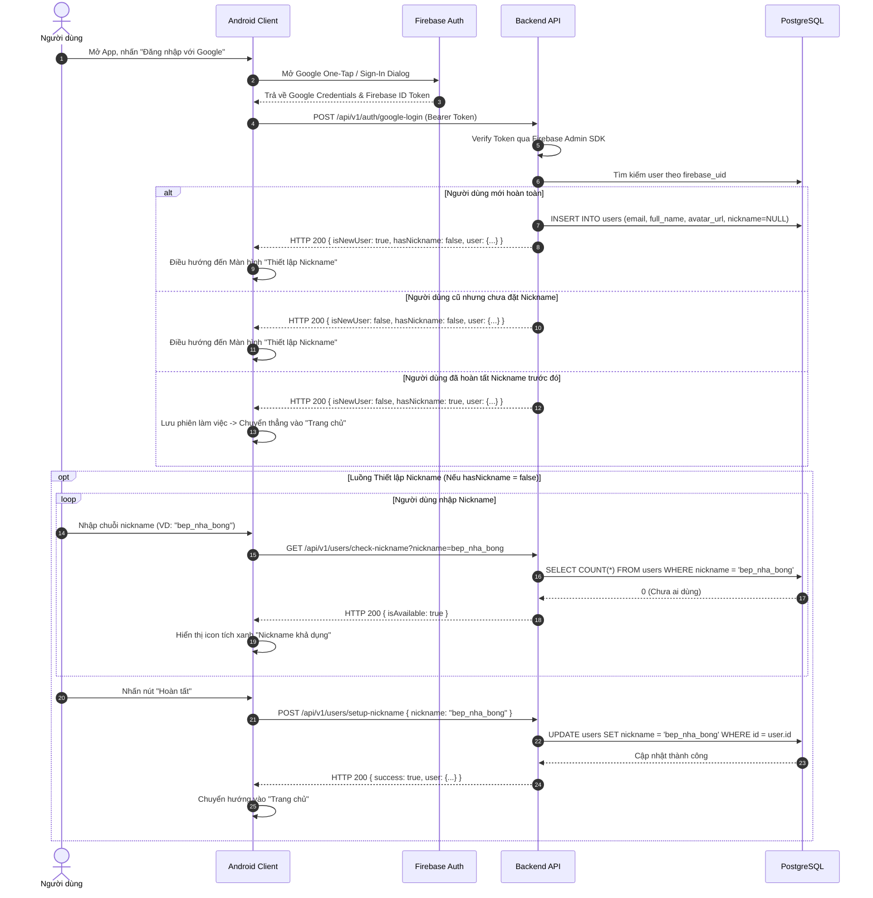

# Đặc Tả Luồng Nghiệp Vụ: Xác Thực & Hồ Sơ Người Dùng (Auth & Profile Flow)

Tài liệu này mô tả chi tiết luồng nghiệp vụ tương tác giữa người dùng, ứng dụng Android và máy chủ Backend cho phân hệ **Xác thực và Thiết lập Hồ sơ cá nhân (Giai đoạn 1)**.

---

## 1. Luồng Đăng nhập Google & Bắt buộc Tạo Nickname Lần đầu

### 1.1. Bối cảnh nghiệp vụ
Mỗi tài khoản đăng nhập qua Google đều có một `email` và `full_name`. Tuy nhiên, trong ứng dụng mạng xã hội ẩm thực này, mỗi người dùng **bắt buộc phải có một `nickname` độc nhất** để:
* Định danh bài viết công thức, bình luận, và ảnh Cooksnap.
* Phục vụ tính năng tìm kiếm đầu bếp trên thanh Global Search.
* Tạo đường dẫn định danh trang cá nhân (Profile URL).

Do đó, người dùng sau khi đăng nhập Google lần đầu tiên **không thể vào thẳng Trang chủ** nếu chưa hoàn tất bước thiết lập nickname.

---

### 1.2. Sơ đồ Luồng Tuần Tự (Sequence Diagram)



---

## 2. Quy tắc Nghiệp vụ Kiểm tra Nickname (Validation Rules)

Backend sử dụng thư viện **Zod** để xác thực tính hợp lệ của `nickname`. Các điều kiện bắt buộc:
1. **Độ dài:** Tối thiểu 3 ký tự, tối đa 30 ký tự.
2. **Ký tự cho phép:** Chỉ chấp nhận chữ cái thường không dấu (`a-z`), chữ số (`0-9`), dấu gạch dưới (`_`) và dấu chấm (`.`).
3. **Không bắt đầu hoặc kết thúc bằng dấu chấm:** Tránh định dạng gây lỗi URL.
4. **Tính độc nhất:** Không trùng lặp với bất kỳ nickname nào đã có trong bảng `users` (so sánh không phân biệt hoa thường).

```typescript
// Zod Schema kiểm duyệt Nickname
export const nicknameSchema = z.string()
  .min(3, "Nickname phải có tối thiểu 3 ký tự.")
  .max(30, "Nickname không được vượt quá 30 ký tự.")
  .regex(/^[a-z0-9._]+$/, "Nickname chỉ được chứa chữ thường, số, dấu chấm và dấu gạch dưới.")
  .refine(val => !val.startsWith('.') && !val.endsWith('.'), "Nickname không được bắt đầu hoặc kết thúc bằng dấu chấm.");
```

---

## 3. Luồng Cấu hình Nguyên liệu Dị ứng Cá nhân (Allergy Settings)

### 3.1. Bối cảnh
Người dùng có thể chủ động khai báo các nguyên liệu gây dị ứng của bản thân (ví dụ: `Hải sản`, `Đậu phộng`, `Sữa`) ngay sau khi vào app hoặc tại trang Cài đặt hồ sơ cá nhân.

### 3.2. Quy trình xử lý
1. Người dùng mở màn hình *Cài đặt dị ứng*.
2. App gọi `GET /api/v1/ingredients?isAllergenCommon=true` để lấy danh sách các nhóm nguyên liệu dễ gây dị ứng phổ biến có sẵn trong từ điển.
3. App đồng thời gọi `GET /api/v1/users/me/allergies` để lấy danh sách ID các nguyên liệu mà người dùng đã lưu trước đó.
4. Người dùng tích chọn / bỏ chọn các mục.
5. Người dùng nhấn "Lưu thay đổi" $\rightarrow$ App gửi `PUT /api/v1/users/me/allergies` kèm danh sách `ingredientIds: [1, 5, 12]`.
6. Backend chạy một Database Transaction:
   - Xóa các bản ghi cũ trong `user_allergies` của người dùng này.
   - Thêm mới các bản ghi theo mảng ID vừa gửi.
7. Từ thời điểm này, mọi truy vấn tìm kiếm công thức hoặc gợi ý tủ lạnh sẽ **tự động loại trừ** các công thức có chứa các `ingredient_id` này.

